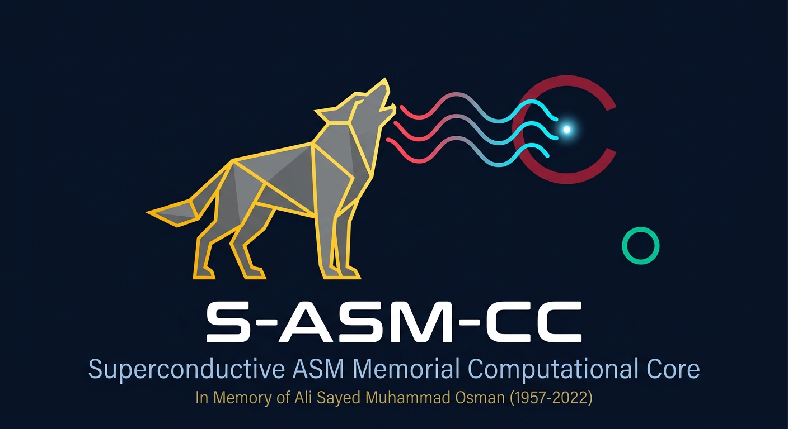

# S-ASM-CC Platform

### Treatment Engine and Hardware Blueprint

*Dedicated to Ali Sayed Muhammad Osman (1957-2022). Every equation. Every simulation. Every result.*

---

## What This Is

Treatment simulation engine and complete preclinical hardware blueprint for the S-ASM-CC Physics Engine (https://github.com/claythe3ed/sasmcc-physics-engine).

Contains S-ASM-CC v5.3 canonical treatment simulation (nine cancer types, all passing), pan-cancer biophysical database from primary AFM literature and assumed water fraction values, nine hardware parameter JSON files, complete preclinical platform blueprint (208 parts, 164 electrical connections, 231 mechanical connections), and three automated consistency hooks.

---

## Quick Start

    pip install numpy scipy matplotlib
    cd src && python3 sasmcc_v53.py
    cd ../hooks
    python3 check_blueprint_vs_database.py
    python3 check_engine_consistency.py
    python3 check_knowledge_graph_sync.py

Expected: all nine cancer types PASS, threshold agreement 0.00%, all hooks exit 0.

---

## Cancer Type Schedule (All 9 Types Now Complete with f_water)

| Type | Frequency | Pa_opt | f_water | Selectivity | Status |
|------|-----------|--------|---------|-------------|--------|
| OSCC | 450 kHz | 0.644 MPa | 0.780 | 73.9x | REFERENCE |
| Breast IDC | 2000 kHz | 0.643 MPa | 0.790 | 965.5x | STIFFNESS_SUPPORTED |
| Prostate | 886 kHz | 0.708 MPa | 0.760 | 1352.3x | STIFFNESS_SUPPORTED |
| Lung NSCLC | 1182 kHz | 0.570 MPa | 0.820 | 55.5x | STIFFNESS_SUPPORTED |
| Colorectal | 1013 kHz | 0.615 MPa | 0.800 | 269.5x | PREDICTED |
| Pancreatic | 709 kHz | 0.744 MPa | 0.740 | 310.8x | STIFFNESS_SUPPORTED |
| Glioblastoma | 1773 kHz | 0.520 MPa | 0.850 | 26.1x | STIFFNESS_SUPPORTED* |
| Cervical | 1182 kHz | 0.607 MPa | 0.800 | 95.7x | STIFFNESS_SUPPORTED |
| Liver HCC | 788 kHz | 0.650 MPa | 0.780 | 190.4x | PREDICTED |

*GBM stiffer than normal brain. Stiffness opposes selectivity; water fraction carries selectivity alone.

Water fractions (cancer and normal) are assumed values, not measurements (see paper, Section 2.8). ADC-based estimates were explored but are not used by the engine. QENS measurements are pending.

---

## Hardware Platform (Design Only)

- Controller: Zynq UltraScale+ MPSoC, FPGA pulse timing <1 us jitter
- RF chain: DDS/DAC -> dual redundant E&I 1040L amps -> 2x8 relay matrix -> 8 PZT transducers
- Turret: Motorized indexed rotary, kinematic mounts, <10 um repeatability
- Safety: Pilz PNOZ Category 3, 7 independent hardwired interlocks
- Phase 0: Benchtop cell culture chamber, 37C, fused quartz acoustic window
- Phase 1: 9 tissue phantoms + small-animal stage, anesthesia, B-mode co-registration
- Cost: $10,200-$16,200 vs $200,000-$500,000 commercial

Full blueprint: hardware/blueprint_v2/

---

## Validation Hooks

| Hook | Result |
|------|--------|
| check_blueprint_vs_database.py | PASS |
| check_engine_consistency.py | 9/9 PASS |
| check_knowledge_graph_sync.py | PASS |

All three pass as of v5.3, knowledge graph v17, 2026-06-23.

---

## References

- Mittelstein et al. (2020). APL 116, 013701. doi:10.1063/1.5128627
- Cross et al. (2007). Nature Nanotechnology 2, 780.
- Ciesluk et al. (2020). Int J Nanomedicine. PMC7547774
- Brás et al. (2022). Cancers 14, 5053. PMC9600571
- PMC4678138 cervical cancer AFM
- Diagnostics 2022. DOI: 10.3390/diagnostics12020332 (Breast IDC f_water)
- OncoTargets 2022. DOI: 10.2147/OTT.S366723 (Prostate f_water)
- Cancers 2020. DOI: 10.3390/cancers12061493 (Lung NSCLC f_water)
- Insights Imaging 2022. DOI: 10.1007/s13244-022-01268-7 (Pancreatic f_water)
- Insights Imaging 2019. DOI: 10.1186/s13244-019-0719-6 (Glioblastoma f_water)
- PLOS ONE 2023. DOI: 10.1371/journal.pone.0285786 (Cervical f_water)
- PLOS ONE 2016. DOI: 10.1371/journal.pone.0153944 (Colorectal f_water)
- Meta-analysis (HCC f_water)

---

## Collaboration

- QENS water fraction data: Martins/Bordallo group, University of Copenhagen
- Relevant experimental group (no collaboration implied): Mittelstein/Shapiro/Gharib group, Caltech
- Institutional: KAIMRC, QBRI, King Hussein Cancer Center

---

## License

MIT. See LICENSE.

*Dedicated to Ali Sayed Muhammad Osman (1957-2022).*

## Status note (14 October 2026)

All results in this repository are computational model outputs. None has been compared with an experimental selectivity measurement. The OSCC value of 88.38x comes from an earlier version of this model (S-ASM-CC v5.1), so the 83.5x vs 88.4x comparison is an internal consistency check. Free-water fractions are assumed values, not measurements; ADC-based estimates were explored but are not used by the engine. Evidence tiers in the paper are REFERENCE (code label VALIDATED, OSCC only), STIFFNESS-SUPPORTED (code label STIFFNESS_VALIDATED) and PREDICTED.
